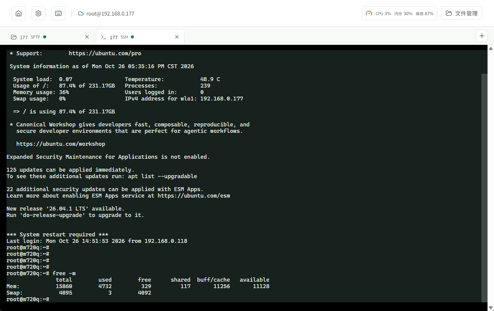
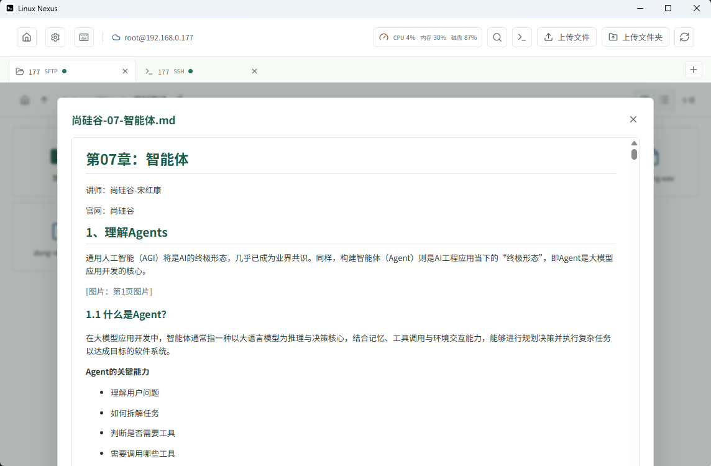

# Linux Nexus

**在 Windows 上一站搞定 Linux 服务器：SFTP 文件管理 + SSH 终端 + 预览与脚本执行。**

不再在 WinSCP、PuTTY、本地编辑器之间来回切换。连接一台服务器后，浏览文件、传文件、看日志、开终端、跑脚本、看 CPU/内存，都在同一个桌面客户端里完成。主场景是 Ubuntu，也适用于 Debian、CentOS 等提供 SSH / SFTP 的常见 Linux。

## 它解决什么问题

日常管几台 Linux 机器时，常见流程是：用 WinSCP 传文件，再切到 PuTTY 跑命令，改配置还要先下载再上传，看日志、预览 Markdown/图片又要另开工具。工具多、窗口多、上下文容易丢。

Linux Nexus 把这些工作收进一个 Windows 桌面应用：多标签同时开多个 SFTP / SSH 会话，文件可预览与在线编辑，脚本可直接在远端执行，会话右上角还能看到 CPU、内存和根分区使用率。

## 适合谁

- 用 Windows 管理 Ubuntu 等 Linux 服务器的个人开发者、运维、兼职管理员
- 需要频繁上传下载、改配置、看日志、跑部署脚本的人
- 想少装几个客户端、少切几个窗口的人

## 和现有工具有什么不同

| 你可能已经在用 | Linux Nexus 怎么做 |
| --- | --- |
| WinSCP / FileZilla | 同样有 SFTP 浏览与传输，并补上终端、预览、脚本执行、轻量监控 |
| PuTTY / Windows Terminal + SSH | 终端可用，但文件浏览、预览、批量传文件仍要另开工具 |
| WebSSH / 面板类产品 | 本机桌面应用，凭据保存在本机并用 Windows 凭据保护，不依赖自建 Web 服务 |

一句话：**不是又一个概念型「运维平台」，而是把日常 SSH/SFTP 操作收拢到一个能马上用起来的 Windows 客户端。**

## 5 分钟上手

### 环境

- Windows
- 开发或自行打包需要 Node.js **22.12+** 与 npm

### 开发运行

```powershell
npm install
npm run dev
```

启动后添加服务器（主机、端口、用户名、密码）→ 连接 → 从 `/` 开始浏览；标签栏可再建 SSH 终端或更多 SFTP 会话。

### 打 Windows 安装包

```powershell
npm run dist:win
```

x64 NSIS 安装包输出在 `release/`。安装后即可直接使用，无需本机再装 SSH/SFTP 客户端。

### 第一次连接注意

- 首次连接会提示核对 SSH 主机指纹，确认后再信任
- 密码不会以明文保存在配置文件中；由 Windows 凭据能力加密保护
- 同一标签对应一条 SSH 连接；可同时开多个标签连接不同服务器或同一服务器的不同会话

## 什么时候你会用到它

- **改完配置立刻验证**：SFTP 打开配置文件预览/编辑，另开终端重启服务看输出
- **传包 + 跑脚本**：上传发布目录或安装包，右键执行 `deploy.sh` / `python3 ./task.py`，输出在执行窗口里看
- **查日志少折腾**：搜索远端文件名或内容，打开 `.log` / `.md` / 图片预览，不必先整文件下载
- **多机切换**：首页管理多台服务器，标签保留各自目录和终端状态，回首页不会关掉已有会话
- **扫一眼机器忙不忙**：会话右上角看 CPU / 内存 / 根分区，点开可看近 15 分钟趋势（读 `/proc`，无需远端装代理）

## 功能一览

| 能力 | 说明 |
| --- | --- |
| [服务器连接与安全](docs/服务器连接与安全.md) | 保存连接、置顶排序、主机指纹校验、本机加密保存密码 |
| [多会话与 SSH 终端](docs/多会话与SSH终端.md) | 多标签 SFTP / SSH，互切不丢状态，轻量性能监控 |
| [文件浏览与操作](docs/文件浏览与操作.md) | 图标/列表视图、框选、拖放移动、复制剪切粘贴、删除与新建 |
| [文件传输](docs/文件传输.md) | 上传下载文件或文件夹，看进度，可取消 |
| [文件搜索](docs/文件搜索.md) | 按文件名或文本内容搜远端 |
| [文件预览](docs/文件预览.md) | 文本（可编辑回写）、Markdown、PDF、图片、音视频 |
| [远端脚本执行](docs/脚本执行.md) | 在服务器上直接跑脚本，看输出，可停止 |
| [应用设置](docs/应用设置.md) | 外观、启动连接、命令别名、文件类型、传输并发、监控与预览上限 |

## 界面预览

### 文件管理


### SSH 终端



### 文件预览



### 设置与辅助


## 当前范围

- 目标客户端：Windows
- 目标服务器：Ubuntu 及常见 Linux（需 SSH + SFTP；监控依赖 `/proc`）
- 认证：目前文档与实现以密码认证为主（详见连接与安全文档）

更多细节见 `docs/` 下各功能说明。
