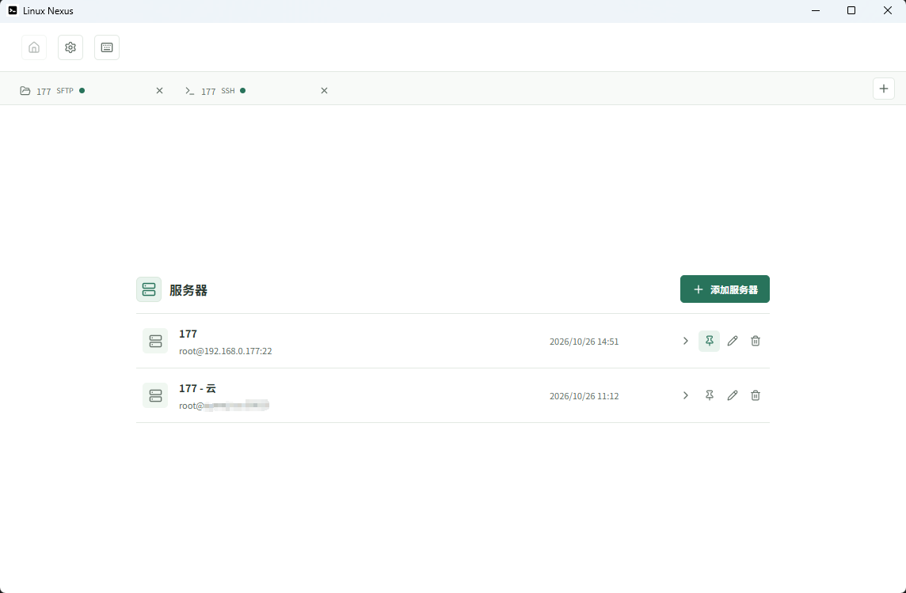
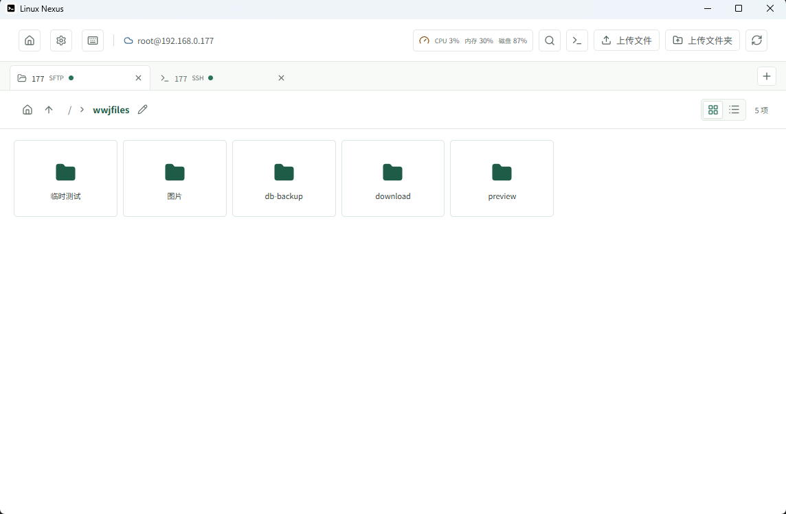
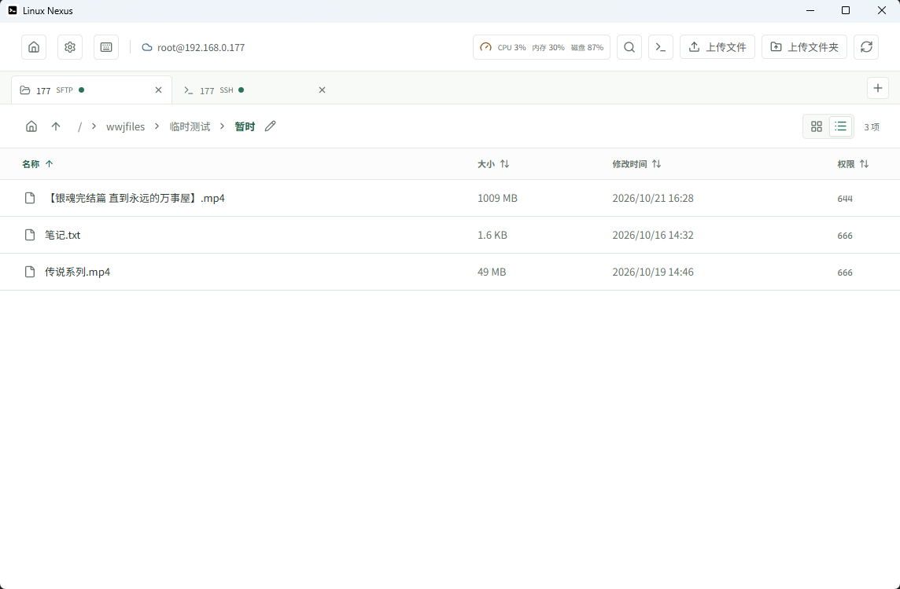
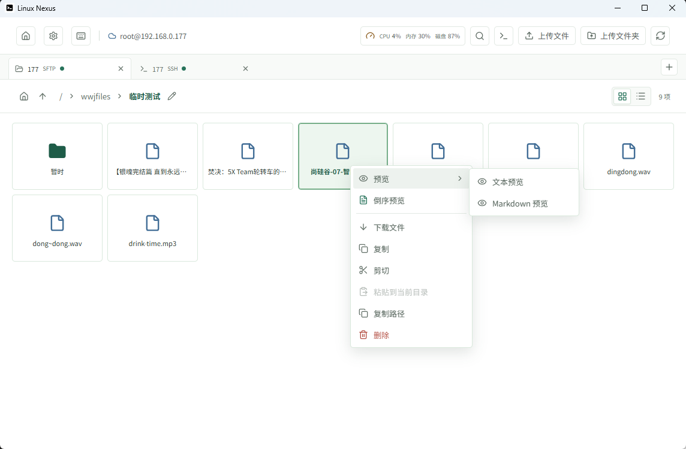
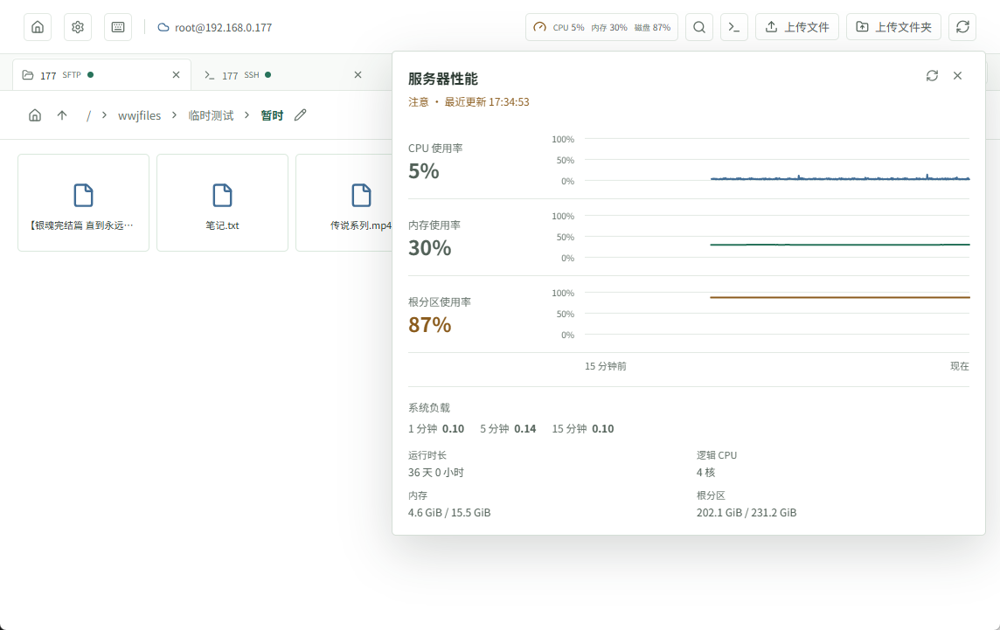
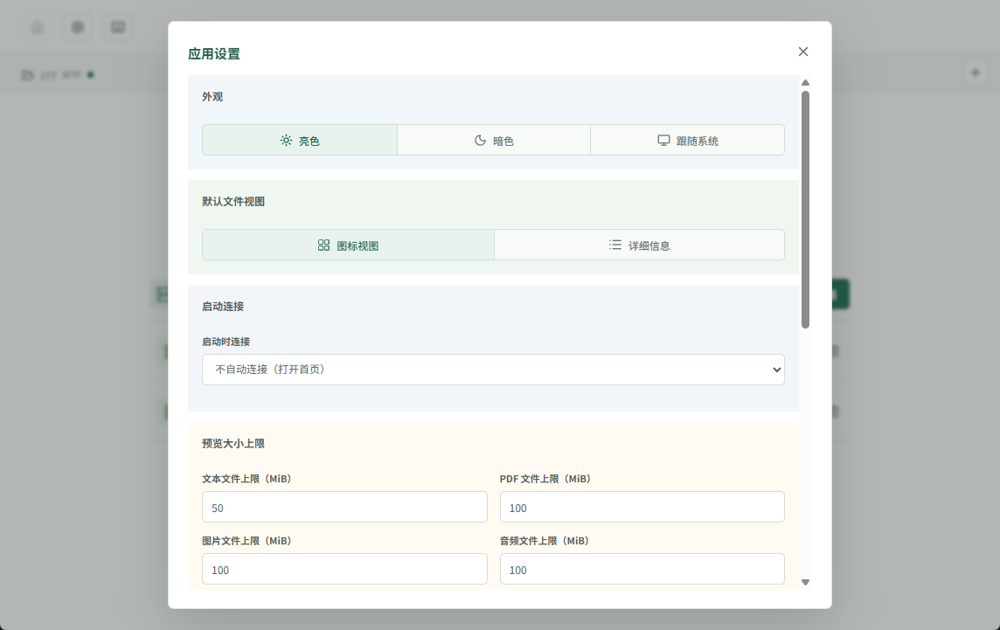
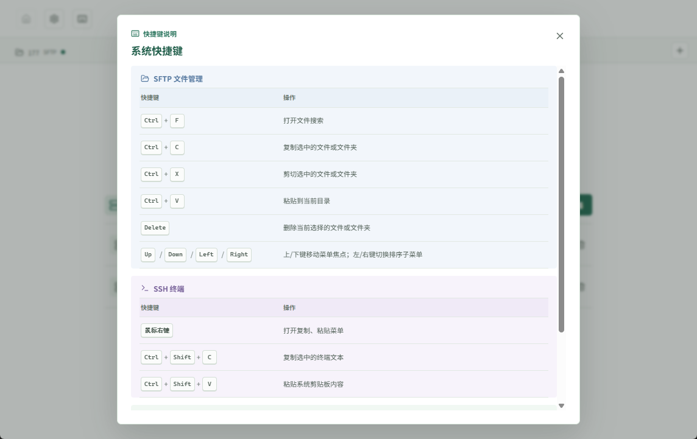

# Linux Nexus

**用 Windows 图形界面管理 Linux 服务器文件，并直接执行远端 SSH 命令。**

## 主要能力

- 文件管理：目录浏览、搜索、上传下载、复制移动、重命名、删除和解压。
- SSH 会话：多标签文件管理与终端，同时连接多台服务器。
- 预览与工具：文本、Markdown、图片、PDF、音视频和日志预览，以及远端脚本执行、命令别名和性能监控。

## 核心设计原则

文件管理器通过图形界面收集参数，经 SSH 命令通道调用服务器原生命令，远端复制和移动的文件内容不经 Windows 中转。
多步操作先记录已知信息，待交互补齐参数后再生成命令并通过 SSH 执行。

## 运行

开发运行需要 Windows、Node.js 22.12+ 和 npm：

```powershell
npm install
npm run dev
```

生成 x64 NSIS 安装包：

```powershell
npm run dist:win
```

## 文档

各模块功能、服务器要求和操作规则详见：

- [服务器连接与安全](docs/服务器连接与安全.md)
- [多会话与 SSH 终端](docs/多会话与SSH终端.md)
- [文件浏览与操作](docs/文件浏览与操作.md)
- [文件传输](docs/文件传输.md)
- [文件搜索](docs/文件搜索.md)
- [文件预览](docs/文件预览.md)
- [远端脚本执行](docs/脚本执行.md)
- [应用设置](docs/应用设置.md)

## 界面截图

### 首页



### 文件管理



### 详细列表



### 右键菜单



### Markdown 文件预览


### SSH 终端


### 性能监控



### 设置



### 快捷键说明


